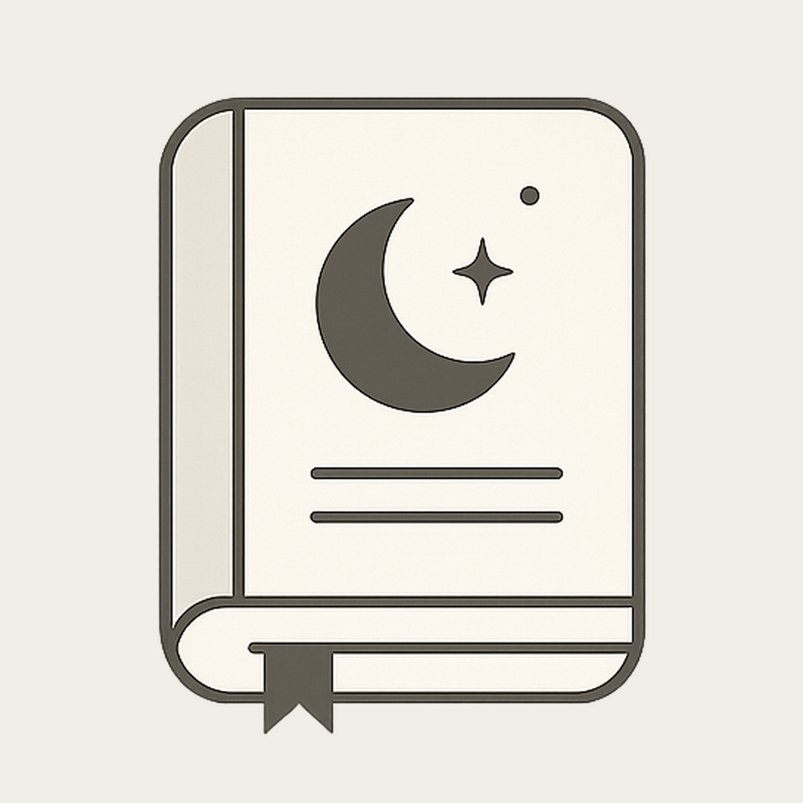
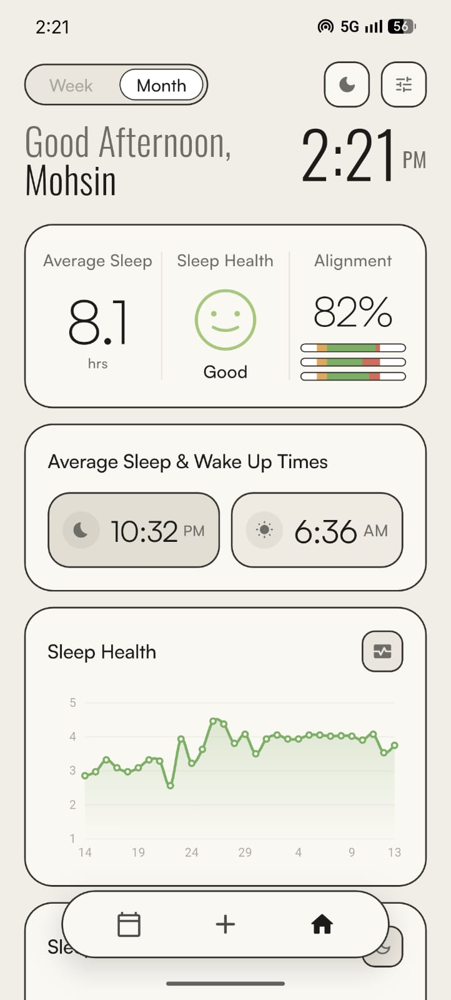
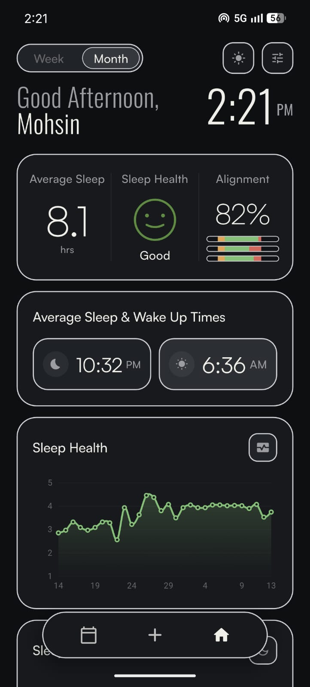
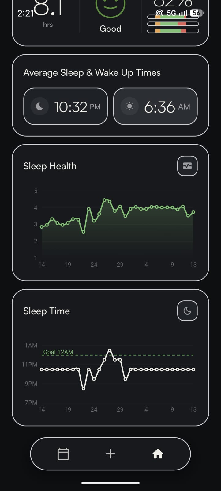
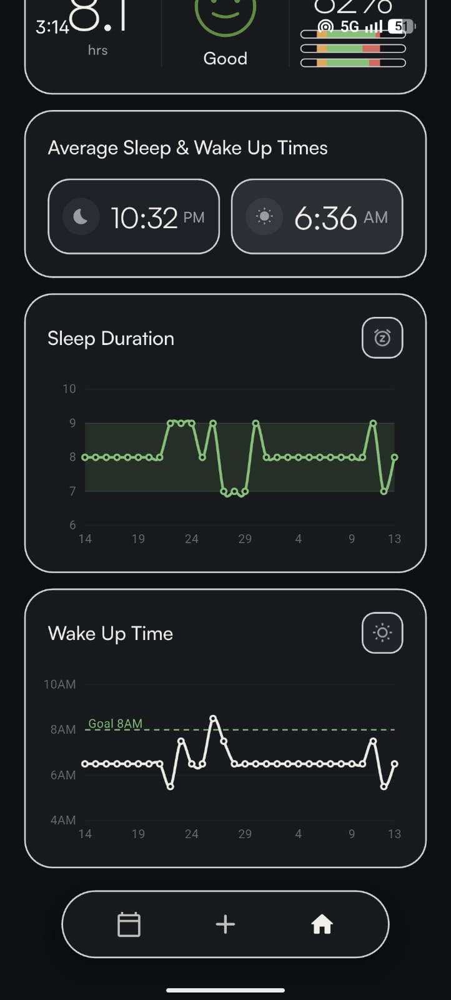
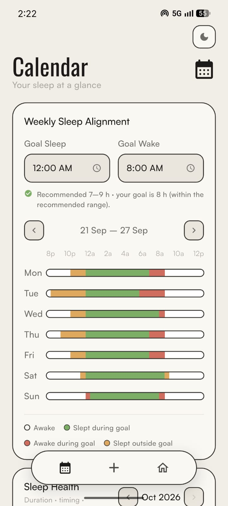
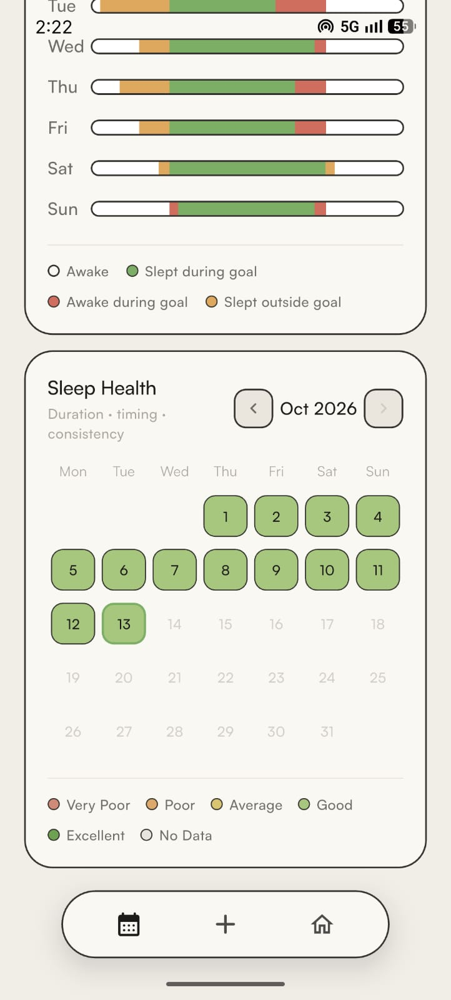
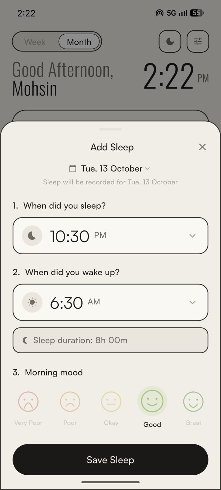

<p align="center">
  
</p>

<h1 align="center">The Sleep Journal</h1>

<p align="center">
  A quiet, single-user sleep tracker for Android, built in Flutter.<br/>
  Hand-painted charts · light &amp; dark themes · fully offline.
</p>

<p align="center">
  
  &nbsp;&nbsp;
  
</p>

---

Everything is **wake-date based**: a night is attributed to the day you *wake up*
(asleep 8 Jun 22:00 → awake 9 Jun 08:00 is recorded under **9 Jun**). The
database key enforces this, so no metric can drift on the convention.

## Features

- **At-a-glance tiles** — Average Sleep, Sleep Health (a mood face that changes
  with your score) and Alignment %, with mini alignment bars.
- **Average sleep & wake pills** — circular-mean bed/wake times, so 23:30 and
  00:30 average to midnight, not noon.
- **Toggleable graphs** — Sleep Duration ↔ Sleep Health, and Sleep Time ↔ Wake
  Up Time, with your goal drawn as a dashed line.
- **Weekly Sleep Alignment timeline** — a custom bar chart showing exactly where
  each night overlapped (or missed) your goal window.
- **Sleep Health heatmap calendar** — every night coloured Very Poor → Excellent,
  with month/year navigation over all history.
- **Week / Month switch** that re-windows every metric on the home screen.
- **Light & dark themes** with an animated palette cross-fade.
- **Fast logging** — a bottom sheet with sleep time, wake time, live duration
  and a five-face morning-mood picker.
- **Private by design** — local SQLite only, no accounts, no network, bundled fonts.

## Screenshots

### Home — light & dark

<p align="center">
  
  &nbsp;&nbsp;
  
</p>

A time-aware greeting and live clock sit above the three summary tiles and your
average sleep/wake times. The sun/moon button flips the theme.

### Charts

<p align="center">
  
  &nbsp;&nbsp;
  
</p>

Each chart card has a toggle in its corner that swaps between a pair of graphs:

| Card | Default | Toggled |
|---|---|---|
| Duration / Health | **Sleep Duration**, with the recommended 7–9 h band shaded | **Sleep Health** (1–5) |
| Bed / Wake | **Sleep Time**, with the goal bedtime dashed | **Wake Up Time**, with the goal wake time dashed |

No chart library — every chart is a `CustomPainter`, so theming and animation
are fully under control.

### Calendar — alignment timeline & Sleep Health heatmap

<p align="center">
  
  &nbsp;&nbsp;
  
</p>

Set your **goal sleep** and **goal wake** times (checked against the recommended
range for your age), then see each night of the week on an 8 PM → 12 PM axis:

| Colour | Meaning |
|---|---|
| 🟩 Green | Slept during goal |
| 🟧 Orange | Slept outside goal |
| 🟥 Red | Awake during goal |
| ⬜ White | Awake |

Below it, the monthly heatmap colours every logged night by its Sleep Health band.

### Logging a night

<p align="center">
  
</p>

Tap **+** in the nav island: pick the wake date, sleep time and wake time (the
duration updates live), choose your morning mood, save.

## How the numbers work (`lib/logic/`)

- **Alignment %** = mean over the period of (minutes slept inside the goal
  window ÷ goal-window length).
- **Sleep Health** (1–5, drives the tile, graph and heatmap):
  ```
  base      = 0.60·duration + 0.25·regularity + 0.15·mood
  circadian = 0.40 + 0.60·midpoint-alignment-with-goal
  health    = 1 + 4·(circadian · base)
  ```
  - *Duration* is scored against the NSF recommended range for your age —
    under- **and** over-sleeping cost points.
  - *Regularity* compares the night's timing to your last 14 logged nights.
  - *Mood* is kept light, so one groggy morning can't sink a good schedule.
  - *Circadian* scales everything, so the right hours at the wrong time still score low.

  Weights and spans are constants in `metrics.dart` — tune freely.
- All time math is anchored to 8 PM so nights crossing midnight stay on one axis.

## Architecture

| Path | Role |
|---|---|
| `data/` | `sqflite` table `entries` keyed by `wake_date`; `shared_preferences` for name/goals/theme |
| `logic/` | pure functions: time math, metrics, date helpers |
| `state/app_state.dart` | `ChangeNotifier` (provider) — in-memory entries + windowing queries |
| `theme/app_theme.dart` | light/dark palettes as a `ThemeExtension` (animated lerp) + type scale (Satoshi UI / Oswald display) |
| `widgets/` | hand-painted charts (line, alignment timeline, quality face), cards, nav island, add-sleep sheet |
| `screens/` | onboarding, home, calendar |

## Build the APK

```bash
flutter pub get
flutter build apk --release                 # universal APK
flutter build apk --release --split-per-abi # smaller per-CPU APKs (use arm64-v8a)
```

Output: `build/app/outputs/flutter-apk/`. Install by copying the `.apk` to the
phone and opening it (enable "Install unknown apps" for your file manager).

## Notes

- A fresh install starts **empty**. Log nights via the **+** in the nav island.
  Android Auto Backup is disabled (`allowBackup="false"`) so an
  uninstall → reinstall starts clean (onboarding shows).
- Fonts are **bundled** (`assets/fonts/`): Satoshi for UI/body, Oswald for the
  greeting/clock/headings.
- App id: `com.mohsin.sleeptrack` (display name: *The Sleep Journal*).

## Roadmap

- **Week/Month toggle thumb overflow** — the selected thumb pill can spill past
  the container's rounded outline; fix the inset/clip in `lib/widgets/segmented.dart`.
- **Rounded-edge scroll reveal** — progressively round card corners as they
  scroll under the header.
- **Tuning knobs** — `kCircadianFloor` (timing strictness, currently 0.40) and
  `kRegularityWindow` (currently 14 nights) in `lib/logic/metrics.dart`.
